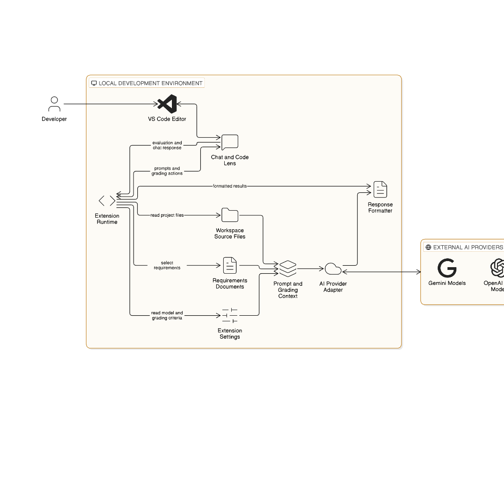
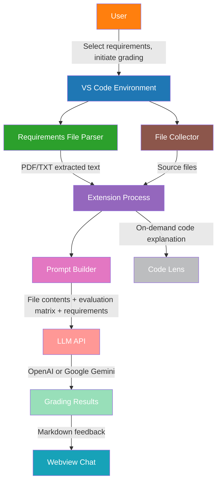

# GradeCode: AI-Powered VS Code Extension

## 📊 Architecture

### Primary Diagram



*1079 × 1062 PNG diagram illustrating the complete grading pipeline*

### Component Overview

The extension follows a **modular pipeline architecture** where project grading flows through 10 specialized components:



#### Component Details

| # | Component | Color | Description |
|---|-----------|-------|-------------|
| 1 | **VS Code Environment** | ⚫ blue | Extension runtime; activates on `extension.start`; registers webview, code lens, settings |
| 2 | **User** | ⚫ orange | Selects requirement files (PDF/TXT); interacts via webview chat; triggers grading |
| 3 | **Requirements File Parser** | ⚫ green | PDF: `pdf-parse` library; TXT: direct read; extracts grading criteria |
| 4 | **File Collector** | ⚫ brown | Recursive project scan; excludes `node_modules/`, `.next/`; reads `.js`, `.ts`, `.tsx`, `.css`, `.py`, etc. |
| 5 | **Extension Process** | ⚫ purple | Orchestrates workflow; validates aspect weights sum to 100%; triggers prompt building |
| 6 | **Prompt Builder** | ⚫ pink | Constructs LLM prompt: file contents + 13-aspect evaluation matrix + user requirements; ensures markdown output format |
| 7 | **LLM API** | ⚫ orange | Two providers: OpenAI (`gpt-3.5-turbo-0125`, `gpt-4o`, `gpt-3.5-turbo`) or Google Gemini (`gemini-1.5-flash`); `src/api.ts` handles both |
| 8 | **Grading Results** | ⚫ teal | AI overall score (1-10); detailed positive/negative feedback per aspect; improvement suggestions |
| 9 | **Webview Chat** | ⚫ blue-client | Main UI; sends user prompts; displays AI grading responses; handles upload command |
| 10 | **Code Lens** | ⚫ gray | "Explain" command on selected code; inline code explanations via `vscode.languages.registerCodeLensProvider` |

#### Data Flow Pipeline

```
User → Requirements File → Extension Process → File Collector → Prompt Builder → LLM API → Grading Results → Webview Chat
                     ↘                                          ↖
                      Code Lens (on-demand)                    Configuration (aspect weights)
```

---

## 🚀 Local Setup

### Prerequisites

- [VS Code](https://code.visualstudio.com/) version `^1.90.0` or higher
- [Node.js](https://nodejs.org/) (for development)
- API key for either:
  - **OpenAI**: Get key from [platform.openai.com](https://platform.openai.com/account/api-keys)
  - **Google Gemini**: Get key from [Google AI Studio](https://makersuite.google.com/app/apikey)

### 1. Clone & Install

```bash
git clone <repository-url>
cd gradecode
npm install
```

### 2. Configure API Key

Add your API key to VS Code settings (`Ctrl+,`):

```json
{
  "gradecode.llmModel": "gpt-4o",  // or gemini-1.5-flash
  "gradecode.apiKey": "sk-YOUR_API_KEY_HERE"
}
```

### 3. Compile

```bash
npm run compile
```

---

## 🏃 Running & Debugging

### Development Workflow

```bash
# Compile and watch for changes
npm run watch

# Or compile once
npm run compile
```

### Debug Mode (F5)

Press **F5** in VS Code to launch the extension host with debugging enabled. The extension will:

- Load the webview UI with chat interface
- Register code lens providers ( "Explain" on selected code)
- Enable chat interface for grading interactions
- Open a new VS Code window with the extension active

### Commands Available

| Command | Trigger |
|---------|---------|
| `extension.start` | Activate the extension |
| `extension.explainCommand` | Explain selected code (via Code Lens) |
| Upload (webview) | Upload requirement file + initiate grading |

### Grading Process (User Flow)

1. **Select a requirements file** - PDF or TXT containing project requirements
2. **Initiate grading** - Use the upload button in the chat interface
3. **Review results** - AI provides overall score and detailed feedback per aspect
4. **Improve code** - Apply suggestions to improve your project

---

## 📁 Project Structure

```
gradecode/
├── src/
│   ├── extension.ts        # Main entry point: activation, webview, code lens
│   ├── api.ts              # API integration: OpenAI & Google Gemini
│   ├── utils.ts            # Utilities: file collection, grading, PDF parsing
│   ├── test/
│   │   └── extension.test.ts  # Test suite (basic assertions)
│   └── ui/
│       ├── script.js       # Webview client logic
│       └── styles.css      # Webview styling
├── package.json            # Extension manifest & dependencies
├── tsconfig.json           # TypeScript configuration
├── README.md               # This file
├── src/media/
│   ├── architecture_diagram.png  # 1079×1062 PNG pipeline diagram
│   ├── architecture.svg      # SVG version of diagram
│   ├── bot.svg             # Bot SVG icon (16×16)
│   └── user.svg            # User SVG icon (16×16)
├── CHANGELOG.md            # Version history
└── package-lock.json       # Pinned dependencies
```

---

## 🛠️ Development

### Available Scripts

| Script | Description |
|--------|-------------|
| `npm run compile` | Compile TypeScript to JavaScript |
| `npm run watch` | Watch and compile on changes |
| `npm run pretest` | Compile + lint before testing |
| `npm run lint` | Lint TypeScript with ESLint |
| `npm test` | Run VS Code extension tests |

### Code Quality

- **ESLint**: `npm run lint` - Enforces code style and catches common errors
- **TypeScript**: `npm run compile` - Type checking and compilation
- Tests: `npm test` - Basic test suite via `vscode-test`

### Adding New Features

1. Modify `src/utils.ts` for grading logic or file operations
2. Update `src/api.ts` for new API integrations (OpenAI/Gemini variants)
3. Enhance `src/extension.ts` for new commands or UI improvements
4. Update webview UI in `src/ui/` (script.js, styles.css)

### Debugging Tips

- Check **Extension Host** console output (F5 debug session)
- Review **webview** console via `webview.webview.console`
- Use `console.log` in `src/utils.ts` for file collection issues
- API key errors appear in VS Code ** Problems ** panel

---

## ⚙️ Configuration

All 13 aspect weightages configurable via VS Code settings (`Ctrl+,`):

| Aspect | Default | Setting Path | Description |
|--------|---------|--------------|-------------|
| 🎯 Functional requirement completion | 50% | `gradecode.requirements.functionalCompletion` | How well requirements are met |
| 📐 Non Functional aspects | 5% | `gradecode.requirements.nonFunctionalAspects` | Overall non-functional quality |
| 🏷️ Naming Convention | 5% | `gradecode.codingAspects.namingConvention` | Variable/function/class naming standards |
| 🏗️ Design Patterns | 5% | `gradecode.codingAspects.designPatterns` | Proper design pattern implementation |
| ✅ Best Practices | 5% | `gradecode.codingAspects.bestPractices` | Code quality and maintainability |
| 🛡️ Error Handling | 5% | `gradecode.codingAspects.errorHandling` | Exception and error management |
| 🔧 Language Constructs | 5% | `gradecode.codingAspects.languageConstructs` | Effective use of language features |
| 💬 Code Comments | 2% | `gradecode.codingAspects.codeComments` | Documentation quality |
| 💀 Dead Code | 3% | `gradecode.codingAspects.deadCode` | Absence of unnecessary code |
| ✅ Positive Test Cases | 4% | `gradecode.unitTestCases.positiveTests` | Test coverage for positive scenarios |
| ❌ Negative Test Cases | 3% | `gradecode.unitTestCases.negativeTests` | Test coverage for edge cases |
| 📊 Coverage | 3% | `gradecode.unitTestCases.coverage` | Test coverage percentage |
| 📖 README | 5% | `gradecode.others.readme` | README quality assessment |

### Critical Constraint

**The total of all aspect values must equal exactly 100%.**

### Configuration Example

```json
{
  "gradecode.llmModel": "gpt-4o",
  "gradecode.apiKey": "sk-your-api-key-here",
  "gradecode.requirements.functionalCompletion": 60,
  "gradecode.requirements.nonFunctionalAspects": 10,
  "gradecode.codingAspects.namingConvention": 5,
  "gradecode.codingAspects.designPatterns": 5,
  "gradecode.codingAspects.bestPractices": 8,
  "gradecode.codingAspects.errorHandling": 5,
  "gradecode.codingAspects.languageConstructs": 5,
  "gradecode.codingAspects.codeComments": 3,
  "gradecode.codingAspects.deadCode": 4,
  "gradecode.unitTestCases.positiveTests": 4,
  "gradecode.unitTestCases.negativeTests": 3,
  "gradecode.unitTestCases.coverage": 3,
  "gradecode.others.readme": 4
}
```

**Verification**: ✅ Total = 60 + 10 + 5 + 5 + 8 + 5 + 5 + 3 + 4 + 4 + 3 + 3 + 4 = **100%**

---

## 💡 Usage

### Basic Workflow

1. **Open a project** in VS Code
2. **Configure LLM model and API key** in settings
3. **Adjust aspect weightages** (must sum to 100%)
4. **Select requirements file** - PDF or TXT via the chat upload button
5. **Initiate grading** - Click upload in the webview chat
6. **Review results** - AI provides score (1-10) and per-aspect feedback
7. **Apply improvements** - Use feedback to enhance your code

### Commands

| Shortcut | Action |
|----------|--------|
| `Ctrl+,` | Open settings to configure GradeCode |
| `F5` | Debug/refresh the extension |
| Right-click → **Explain** | Explain selected code (Code Lens) |

---

## 👥 Contributing

### Guidelines

1. **Fork** the repository
2. **Branch**: `git checkout -b feature/AwesomeFeature`
3. **Commit**: `git commit -m 'Add some AwesomeFeature'`
4. **Push**: `git push origin feature/AwesomeFeature`
5. **Pull Request**: Open a PR with a clear description of changes

### Development Workflow

```bash
# 1. Create feature branch
git checkout -b feature/better-grading

# 2. Make changes (modify source files, update README if needed)

# 3. Lint and test
npm run lint
npm run pretest

# 4. Commit and push
git commit -m "feat: improve grading accuracy"
git push origin feature/better-grading

# 5. Open PR against main branch
```

### Code Standards

- Follow existing code style in `src/`
- Add JSDoc comments for public functions
- Keep aspect weight defaults summing to 100%
- Update configuration example if defaults change

---

## 📜 License

This project is open source. See the repository for license details.

---

## 📞 Contact

- **Author**: Abilash Ravchandran
- **Extension**: GradeCode
- **Version**: 0.0.1
- **Repository**: https://github.com/Abilash-Ravichandran/GradeCode

---

*GradeCode - Making code grading automated and consistent*


---
*Last updated: October 2026*